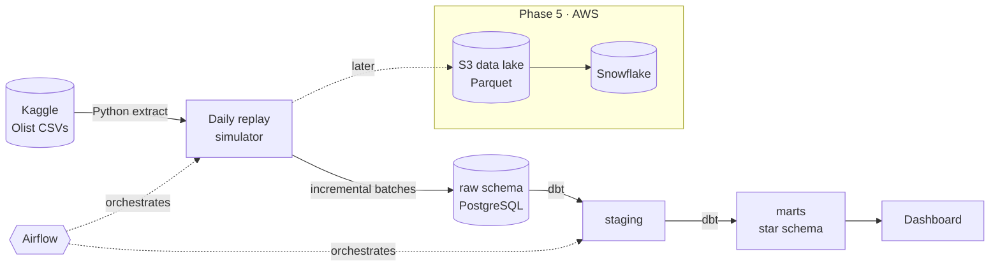

# Olist E-commerce Data Platform

[](https://github.com/miguel-ramirez-data/olist-ecommerce-data-platform/actions/workflows/ci.yml)


An end-to-end data platform for a Brazilian e-commerce marketplace, built on the public
[Olist dataset](https://www.kaggle.com/datasets/olistbr/brazilian-ecommerce): ~100k real orders
(2016–2018) covering customers, orders, items, payments, reviews, products and sellers.

The platform ingests the data as **daily incremental batches**, models it into a **star schema**,
tests it, orchestrates it, and serves business metrics — the same lifecycle as a production pipeline.

> **Status:** 🟡 Phase 0 — Foundation. See the [roadmap](#roadmap).

---

## Business questions

| Area | Question | Metric |
|------|----------|--------|
| Retention | Do customers come back after their first purchase? | Monthly cohort retention |
| Revenue | Where does revenue come from? | GMV and average order value by state, category, seller |
| Logistics | Are deliveries on time, and does lateness hurt satisfaction? | Delivery delay vs. estimate, review score by delay bucket |
| Sellers | Which sellers and categories drive the marketplace? | Revenue share, order volume, average rating |

## Architecture



**Why a replay simulator?** The dataset is a static snapshot. Replaying orders day by day (by purchase
date) turns it into a realistic stream of daily files, so the pipeline has to deal with what production
pipelines deal with: incremental loads, late or duplicated files, idempotent re-runs and backfills.

## Tech stack

| Layer | Tool | Phase |
|-------|------|-------|
| Ingestion | Python (pandas), Kaggle API | 1 |
| Storage (local) | PostgreSQL 16 on Docker | 0 ✅ |
| Transformation | dbt Core | 2 |
| Data quality | dbt tests, dbt-expectations | 3 |
| Orchestration | Apache Airflow | 4 |
| Cloud | AWS S3, Terraform, Snowflake | 5 |
| Serving | Power BI / Metabase | 6 |
| CI/CD | GitHub Actions, Ruff, SQLFluff, pytest, pre-commit | 0 ✅ → 7 |

## Roadmap

| Phase | Scope | Status |
|-------|-------|--------|
| **0 · Foundation** | Repo structure, Dockerized PostgreSQL with `raw` / `staging` / `marts` schemas, config management, CI (lint + tests against a real database), architecture & decision records | 🟡 In progress |
| **1 · Ingestion** | Kaggle download, daily replay simulator, idempotent loads into `raw`, load audit table, unit tests | ⬜ |
| **2 · Modeling** | dbt staging → intermediate → marts; `fct_orders`, `fct_order_items`, `dim_customers`, `dim_products`, `dim_sellers`, `dim_date` | ⬜ |
| **3 · Data quality** | Uniqueness, not-null, relationships, accepted ranges, source freshness, rejected-records report | ⬜ |
| **4 · Orchestration** | Daily Airflow DAG: ingest → `dbt build` → tests; retries, backfills, alerts | ⬜ |
| **5 · Cloud** | S3 data lake (raw / processed Parquet), Terraform, Snowflake warehouse | ⬜ |
| **6 · Serving** | Business dashboard answering the questions above | ⬜ |
| **7 · Hardening** | Full CI/CD (dbt on every PR), monitoring, final documentation | ⬜ |

## Repository structure

```
olist-ecommerce-data-platform/
├── src/olist_platform/      # Python package (config now; ingestion in Phase 1)
├── tests/                   # pytest: unit + database integration tests
├── infra/postgres/init/     # SQL run on first database start (schemas, roles)
├── docs/
│   ├── data-sources.md      # Olist tables and relationships
│   └── decisions/           # Architecture Decision Records (ADRs)
├── data/                    # local data files (git-ignored)
├── .github/workflows/ci.yml # lint + tests on every push / PR
├── docker-compose.yml
└── pyproject.toml
```

## Quick start

Requirements: Docker Desktop, Python 3.12+, Git.

```bash
git clone https://github.com/miguel-ramirez-data/olist-ecommerce-data-platform.git
cd olist-ecommerce-data-platform

cp .env.example .env                 # local credentials (never committed)
docker compose up -d                 # PostgreSQL with raw / staging / marts schemas

python -m venv .venv
source .venv/bin/activate            # Windows: .venv\Scripts\activate
pip install -e ".[dev]"
pre-commit install

pytest                               # unit + integration tests
```

## Engineering principles

- **Idempotent by design** — any day can be re-loaded without creating duplicates.
- **Layered data** — `raw` is an untouched copy of the source; all cleaning happens downstream.
- **Tested before trusted** — CI runs linters and tests against a real PostgreSQL container on every PR.
- **Configuration over hard-coding** — credentials and settings come from environment variables.
- **Decisions are documented** — see [`docs/decisions/`](docs/decisions/).

## Data source & license

Data: *Brazilian E-Commerce Public Dataset by Olist*, published on Kaggle under
[CC BY-NC-SA 4.0](https://creativecommons.org/licenses/by-nc-sa/4.0/). The data is not
redistributed in this repository; it is downloaded at runtime. Code is MIT-licensed.

---

**Miguel Ramírez** · Guadalajara, Mexico · [GitHub](https://github.com/miguel-ramirez-data)
