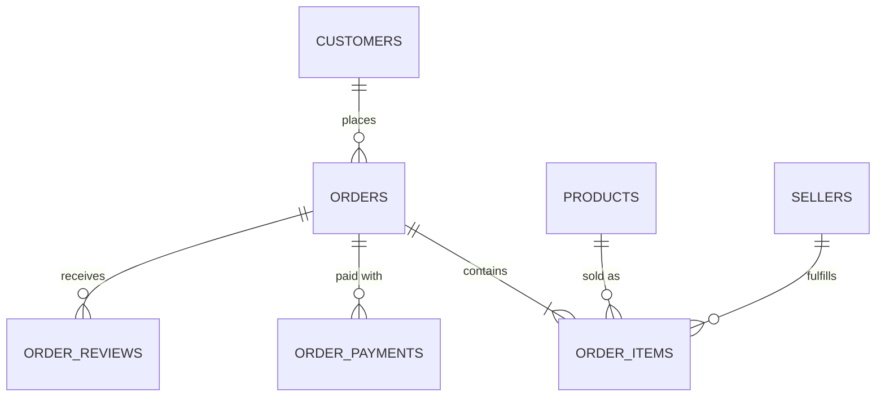

# Data sources

**Dataset:** Brazilian E-Commerce Public Dataset by Olist —
<https://www.kaggle.com/datasets/olistbr/brazilian-ecommerce> (CC BY-NC-SA 4.0)

Real, anonymized orders placed on the Olist marketplace between 2016 and 2018
(~100k orders). Company and partner names in reviews were replaced; the data is
otherwise as published.

## Files

| File | Grain | Key | Target table |
|------|-------|-----|--------------|
| `olist_orders_dataset.csv` | one row per order | `order_id` | `raw.orders` |
| `olist_order_items_dataset.csv` | one row per item in an order | `order_id` + `order_item_id` | `raw.order_items` |
| `olist_order_payments_dataset.csv` | one row per payment installment/method | `order_id` + `payment_sequential` | `raw.order_payments` |
| `olist_order_reviews_dataset.csv` | one row per review | `review_id` | `raw.order_reviews` |
| `olist_customers_dataset.csv` | one row per customer per order | `customer_id` (per order) / `customer_unique_id` (person) | `raw.customers` |
| `olist_products_dataset.csv` | one row per product | `product_id` | `raw.products` |
| `olist_sellers_dataset.csv` | one row per seller | `seller_id` | `raw.sellers` |
| `olist_geolocation_dataset.csv` | zip-code prefix → lat/lng (many rows per prefix) | — | `raw.geolocation` |
| `product_category_name_translation.csv` | Portuguese → English category | `product_category_name` | `raw.category_translation` |

## Relationships

## Known quirks to handle downstream

- `customer_id` is **per order**; use `customer_unique_id` to identify a person
  (critical for retention metrics).
- Geolocation has many coordinates per zip-code prefix → needs deduplication.
- Product category names are in Portuguese → join the translation table.
- Some orders are missing delivery timestamps (cancelled / unavailable status).
- Review records can repeat across orders.

## Replay strategy (Phase 1)

Orders are split by `order_purchase_timestamp::date`. The simulator emits one
batch per day — the orders of that day plus their items, payments and reviews —
into `data/landing/<table>/dt=YYYY-MM-DD/`. Dimension files (products, sellers,
geolocation, translation) are loaded once as reference data.
